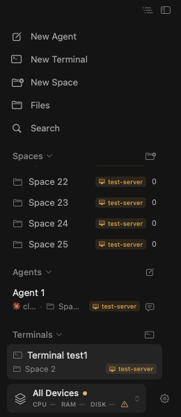
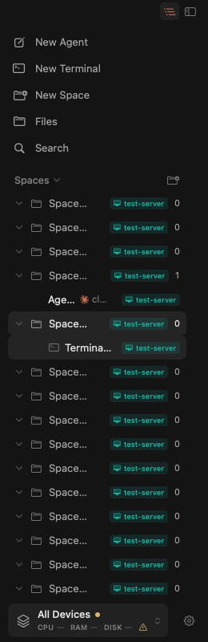

# Terminal input focus keeps the sidebar in place

These synthetic screenshots demonstrate [PR #207](https://github.com/missuo/herdrm/pull/207), based on product commit [`84c89f7`](https://github.com/missuo/herdrm/commit/84c89f72dfa2d9cab03e5276bba43cf8cf764282).

Each pair shows the fixed build immediately before and after clicking the right-hand ordinary terminal input. The selected terminal row stays in the same position. The images contain only generated `Space N`, `Agent 1`, `Terminal test1`, and `test-server` data.

| Layout | Before input click | After input click |
| --- | --- | --- |
| Flat |  |  |
| Grouped |  |  |

## Reproduction and evidence

[GitHub Actions run 41986942567](https://github.com/bw-rsp/herdrm/actions/runs/41986942567) ran these two real AppKit click tests at demo commit [`8532e76`](https://github.com/bw-rsp/herdrm/commit/8532e7642c467725ad1efbfb3d00083219846db2):

- `SidebarSpaceRevealUIUXTests.testClickingAgentAndTerminalRowsKeepsFlatSidebarStill`
- `SidebarSpaceRevealUIUXTests.testClickingAgentAndTerminalRowsKeepsGroupedSidebarStill`

Both tests passed: **2 tests, 0 failures**. Each selects both an Agent and an ordinary terminal from the sidebar, hit-tests the corresponding `LineBreakTerminalView`, then clicks its input twice. The assertions check keyboard focus, selected pane, sidebar scroll offset, row positions, and preservation of All Spaces. The fixture starts no PTY, SSH connection, or Agent process.

The four images above are the ordinary-terminal before/after frames, downloaded from that run and visually checked. The Agent input path is covered by the same tests. The full eight-test sidebar suite in the product PR additionally covers split-pane input focus, initial restoration, Files return, cross-device navigation, and explicit search/notification jumps.

The screenshot hooks and narrowed workflow exist only on `demo/input-focus-sidebar`; they are not part of the product PR.
