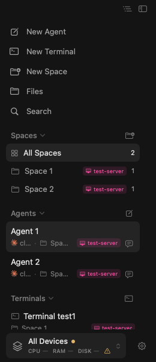
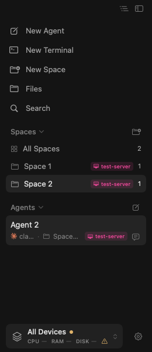

# Sidebar highlight follows the active space filter

These are two states of the fixed application, rendered by the real macOS
`SidebarView` with synthetic `Space 1`, `Space 2`, `Agent 1`, `Agent 2`, and
`test-server` data. No real project, host, account, or terminal content is included.

| All Spaces selected | Space 2 selected |
| --- | --- |
|  |  |

The first image shows a restored Agent 1 pane while the sidebar still lists
both agents: All Spaces is therefore the selected filter. The second image
follows a click on Space 2 and repeated clicks on its terminal input. Only
Agent 2 remains in the list, and Space 2 stays highlighted.

## Test and capture method

`SidebarSpaceRevealUIUXTests.testRestoredPaneAndInputFocusKeepHighlightAlignedWithSpaceFilter`
uses the real `SidebarHarness`, native AppKit hit-testing, and the production
terminal activation callback. Its input views do not start a PTY or SSH session.
The test checks the selected accessibility trait, the filtered agent and
terminal lists, and stable scrolling after repeated input clicks. It also
checks returning to All Spaces while keeping the displayed pane.

The existing native snapshot helper captured these two PNGs during that test.
Both images were downloaded from the CI artifact and visually checked for
correct highlight, visible agent rows, and absence of private data.

## Red and green evidence

- The [first run, 41994521012](https://github.com/bw-rsp/herdrm/actions/runs/41994521012), substituted only `SidebarView.swift` from the old [`84c89f7`](https://github.com/bw-rsp/herdrm/commit/84c89f72dfa2d9cab03e5276bba43cf8cf764282) implementation. The new test ran to completion with **8 assertion failures, 0 unexpected failures**, including the named `DEMO_FILTER_ALL_SPACES_SELECTED` assertion. A compile error alone could not satisfy the red-phase check.
- That run's subsequent fixed-version phase **failed because the XCTest host hung before connecting**. No test case began in that phase, and it produced no green screenshots. The overall failed run is not presented as successful verification.
- The [fresh-runner run, 41996157228](https://github.com/bw-rsp/herdrm/actions/runs/41996157228), tested the fixed [`2d6add4`](https://github.com/bw-rsp/herdrm/commit/2d6add44db6be504662d34fe6f792035a68d6e13) product code: **1 test passed, 0 failures**, in 5.208 seconds. The screenshots above are from this successful run's `synthetic-ui-demos` artifact. Only this targeted test was retried; the old phase and full suite were not repeated.

The screenshot hooks and targeted workflow are confined to the independent
`demo/sidebar-filter-selection` branch. The product pull request's workflow
is unchanged.
