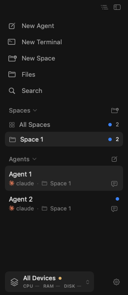
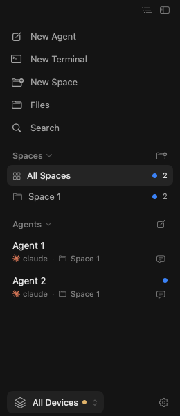

# Unread results survive client relaunch

These screenshots use the real macOS `SidebarView` with synthetic `Space 1`,
`Agent 1`, and `Agent 2` data. They contain no user projects, remote hosts,
account names, or terminal contents.

| Before recreating the model and sidebar | New model loads the saved attention state |
| --- | --- |
|  |  |

Agent 1 was opened before the first screenshot, so it has no blue dot. Agent 2
was left unread and keeps its blue dot in the new sidebar. The space and All
Spaces rows also retain the aggregate unread indicator. Selection restoration
is not the subject of this demonstration.

## How this was captured

The existing
`AgentUnreadUIUXTests.testRelaunchRestoresOnlyUnreadResultsAndClicksPersistAcknowledgement`
clicks the first agent through AppKit hit-testing, then creates a new real
`AppModel` and `SidebarHarness` using the same isolated `UserDefaults` suite.
Each fresh sidebar is captured once with the existing native snapshot helper.
This exercises the client's initialization and persistence path; it is not a
recording of a real user session or an operating-system process restart.

The test also verifies that restoring the unread result does not replay a
completion notification, reading Agent 2 remains acknowledged in another new
model, and a newer result completed while the client was closed is reported.

- Product fix: [`21c89b1`](https://github.com/bw-rsp/herdrm/commit/21c89b17ce170892b0755f7e2b08e9113375868d).
- Demo instrumentation: [`2f696eb`](https://github.com/bw-rsp/herdrm/commit/2f696eb0ff16d9a01f5182fbcfb015d942d694e0).
- [GitHub Actions run 41991149785](https://github.com/bw-rsp/herdrm/actions/runs/41991149785): **1 test passed, 0 failures**, on macOS arm64.
- The two PNGs were downloaded from that run's `synthetic-ui-demos` artifact and visually checked before publication.

Screenshot hooks and the targeted workflow exist only on the independent
`demo/unread-persistence` branch. The product pull request's workflow is unchanged.
