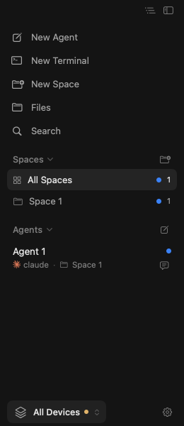

# Unread results remain visible during status recovery

This is the real macOS `SidebarView`, rendered with synthetic `Agent 1` and
`Space 1` data. A completed result is still unread. Subsequent recovery events
report `idle` and then `unknown` without a completion sequence; neither event
acknowledges that result. The screenshot shows the blue dot remaining on the
agent, its space, and All Spaces.

## Evidence

- Product change: [`234a8d6`](https://github.com/bw-rsp/herdrm/commit/234a8d6db126cf33e407d474a70bb398e2387591), proposed in [PR #209](https://github.com/missuo/herdrm/pull/209).
- [GitHub Actions run 42188591955](https://github.com/bw-rsp/herdrm/actions/runs/42188591955): **1 test passed, 0 failures**, in 3.256 seconds.
- Target: `AgentUnreadUIUXTests.testRecoveryStatusEventsKeepUnreadVisibleAndPersistedUntilOpened`.

The test feeds recovery events through the production event handler, checks
persisted unread state in a newly initialized model, verifies the space's
unread indicator and the agent's accessibility badge, and captures the real
sidebar. It later checks that opening the agent clears the result, replaying
the same completion produces no new notification, and an authoritative read
snapshot still acknowledges a later result.

The PNG is the test's existing `XCTAttachment`, exported from the run's
`build/Logs/Test/*.xcresult` with `xcresulttool export attachments`. It was
downloaded from the `synthetic-ui-demos` artifact and visually checked before
publication. It is an anonymous fixture demonstration, not a recording of a
real user's network reconnection. No project, host, account, or terminal
contents from a real user are included.

Only the independent `demo/unread-recovery` branch changes the workflow to run
this one green test and export its attachment. Product source, tests, and the
product pull request's workflow are unchanged by the demo. No old red phase or
full test suite was repeated for these screenshots.
